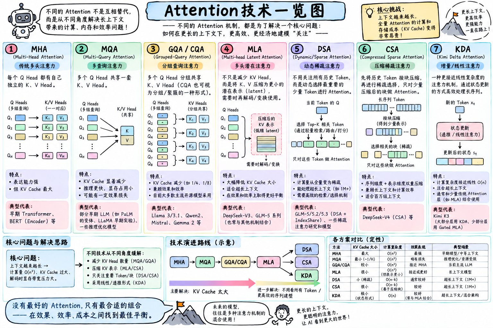

來源： https://x.com/xuanyuanzhifeng/status/2097334957610017077/photo/1

這張圖表整理了大語言模型（LLM）為了解決「上下文變長時，計算量爆增與 KV Cache 記憶體占用過大」的核心難題，所演進出的 7 種主要 **Attention（注意力）機制變體**。

以下為您詳細拆解這 7 大技術的核心原理、優缺點與代表模型：

---

### 1. 基礎與優化結構（聚焦於 KV 權重共享與壓縮）

#### ① MHA (Multi-Head Attention) - 多頭注意力

* **核心原理**：每個 Query Head ($Q$) 都擁有自己獨立對應的 Key ($K$) 與 Value ($V$) Head，呈現 $1:1$ 一對一關係。
* **特點**：表達能力最強、捕捉細節最精準，但 **KV Cache 占用最大**，在高併發或長上下文時極易造成顯存（VRAM）爆滿。
* **代表模型**：早期 Transformer、BERT、GPT-2。

#### ② MQA (Multi-Query Attention) - 多查詢注意力

* **核心原理**：所有的 $Q$ Head 共享**同一個** $K$ 與 $V$ Head（$N:1$）。
* **特點**：大幅削減 KV Cache 大小（縮小至原本的 $1/H$），推理速度極快；但由於大幅壓縮了空間，**模型表達效果有一定損失**。
* **代表模型**：PaLM、Falcon、LLaMA 早期實驗。

#### ③ GQA / CQA (Grouped-Query Attention) - 分組查詢注意力

* **核心原理**：MHA 與 MQA 的折衷方案。將 $Q$ Head 分組（例如 8 個 $Q$ 為一組），每組共享一套 $K/V$ Head。
* **特點**：顯著降低 KV Cache 占用，同時幾乎維持了與 MHA 相當的模型效果，是**目前主流開源模型最廣泛採用的平衡方案**。
* **代表模型**：Llama 3/3.1、Qwen2、Mistral、Gemma 2。

#### ④ MLA (Multi-head Latent Attention) - 多頭潛在注意力

* **核心原理**：不直接減少 Head 的數量，而是將 $K$ 與 $V$ 投影壓縮到一個低維度的潛在空間（Latent Space）中儲存，需要計算時再即時解碼/變換。
* **特點**：大幅降低 KV Cache 大小至極低水平，適合超長上下文，在效果與效率間取得優異平衡。
* **代表模型**：DeepSeek-V3、GLM-5 系列。

---

### 2. 稀疏與線性架構（聚焦於減少計算的 Token 數量或複雜度）

#### ⑤ DSA (Dynamic/Sparse Attention) - 動態稀疏注意力

* **核心原理**：當前的 $Q$ 不需要關注歷史所有的 Token，而是透過輕量檢索/路由機制，**動態選擇最相關的少數 Token (Top-K)** 來做 Attention 計算。
* **特點**：計算量從全量 $O(n^2)$ 變為稀疏計算，能處理百萬級（1M+）超長上下文，但需要高效的動態索引機制。
* **代表模型**：GLM-5/5.2/5.3 (DSA + IndexShare)。

#### ⑥ CSA (Compressed Sparse Attention) - 壓縮稀疏注意力

* **核心原理**：先將歷史 Token 按區塊（Block）進行壓縮得到少量表示，再對壓縮後的區塊進行稀疏選擇，只對相關區塊做 Attention。
* **特點**：**序列維度與表示維度雙重壓縮**，大幅提升計算效率，適合百萬級上下文處理。
* **代表模型**：DeepSeek-V4 (CSA) 等。

#### ⑦ KDA (Kimi Delta Attention) - 增量/線性注意力

* **核心原理**：接近線性複雜度 $O(n)$ 的注意力機制，透過「遞迴/線性注意力」的方式，將歷史資訊儲存在固定的狀態（State）中，以狀態更新（Delta Update）來處理新 Token。
* **特點**：計算複雜度接近 $O(n)$，極度節省記憶體，通常與少量傳統 Attention 混合使用。
* **代表模型**：Kimi K3（大部分層用 KDA，少數層用 Gated MLA）。

---

### 3. 各方案定性對比總結

| 方法 | KV Cache 大小 | 計算複雜度 | 效果表現 | 典型應用場景 |
| --- | --- | --- | --- | --- |
| **MHA** | 最大 | $O(n^2)$ | 最強 | 早期模型 / 中短上下文 |
| **MQA** | 最小 ($\sim 1/H$) | $O(n^2)$ | 略有損失 | 推理優化 / 資源受限 |
| **GQA** | 較小 | $O(n^2)$ | 接近 MHA | **當前主流 LLM** |
| **MLA** | 很小 | $O(n^2)$（但表示更小） | 接近或更好 | 長上下文模型 |
| **DSA** | 小（稀疏） | $O(n \cdot k)$ | 通常較好 | 超長上下文 (1M+) |
| **CSA** | 很小 | $O(n \cdot k)$（基於壓縮塊） | 較好 | 超長上下文 (1M+) |
| **KDA** | 極小（狀態形式） | $O(n)$ | 較好（常與 MLA 結合） | 超長上下文 / 混合架構 |

---

### 💡 核心結論與演進趨勢

1. **核心痛點**：上下文越長 $\rightarrow$ 計算量以平方倍 $O(n^2)$ 增加、KV Cache 爆滿 $\rightarrow$ 解碼時記憶體頻寬受限。
2. **演進路線**：`MHA` $\rightarrow$ `MQA` $\rightarrow$ `GQA/CQA` $\rightarrow$ `MLA` $\rightarrow$ `DSA / CSA / KDA`。
3. **未來的趨勢**：**沒有最好的 Attention，只有最合適的組合**。未來的超長上下文模型往往採用多種注意力機制混合（Hybrid）使用（例如：大部分層用線性/稀疏 Attention 降本增效，少數關鍵層保留全量/高精度 Attention 確保理解力）。