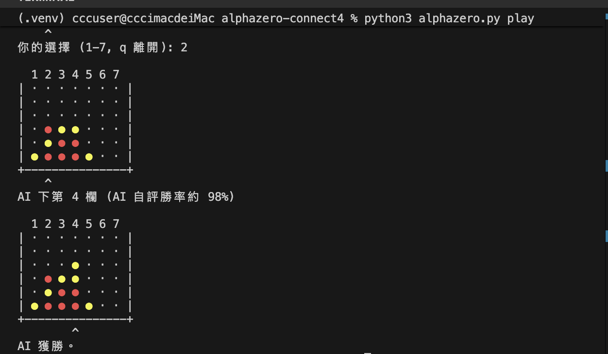

# Connect4

## AlphaZero 訓練

```
(.venv) cccuser@cccimacdeiMac alphazero-connect4 % python3 alphazero.py train --minutes 10
裝置: mps
[輪 1] 自我對弈 64 盤 (平均 22.2 手) | policy loss 1.920 value loss 0.460 | 資料 2848 | 本輪 22s, 累計 0.4 分
[輪 2] 自我對弈 64 盤 (平均 24.4 手) | policy loss 1.825 value loss 0.469 | 資料 5974 | 本輪 16s, 累計 0.6 分
[輪 3] 自我對弈 64 盤 (平均 22.4 手) | policy loss 1.737 value loss 0.424 | 資料 8842 | 本輪 16s, 累計 0.9 分
[輪 4] 自我對弈 64 盤 (平均 22.0 手) | policy loss 1.671 value loss 0.408 | 資料 11660 | 本輪 16s, 累計 1.2 分
[輪 5] 自我對弈 64 盤 (平均 24.2 手) | policy loss 1.633 value loss 0.406 | 資料 14752 | 本輪 17s, 累計 1.4 分
   ↳ 對 alpha-beta(深度4) 20 盤: 5 勝 0 和 15 負
[輪 6] 自我對弈 64 盤 (平均 22.1 手) | policy loss 1.607 value loss 0.400 | 資料 17582 | 本輪 16s, 累計 1.9 分
[輪 7] 自我對弈 64 盤 (平均 24.5 手) | policy loss 1.588 value loss 0.418 | 資料 20714 | 本輪 18s, 累計 2.2 分
[輪 8] 自我對弈 64 盤 (平均 23.1 手) | policy loss 1.576 value loss 0.403 | 資料 23670 | 本輪 18s, 累計 2.4 分
[輪 9] 自我對弈 64 盤 (平均 25.7 手) | policy loss 1.561 value loss 0.434 | 資料 26954 | 本輪 22s, 累計 2.8 分
[輪 10] 自我對弈 64 盤 (平均 24.3 手) | policy loss 1.554 value loss 0.442 | 資料 30060 | 本輪 19s, 累計 3.1 分
   ↳ 對 alpha-beta(深度4) 20 盤: 8 勝 0 和 12 負
[輪 11] 自我對弈 64 盤 (平均 27.0 手) | policy loss 1.537 value loss 0.469 | 資料 33510 | 本輪 18s, 累計 3.6 分
[輪 12] 自我對弈 64 盤 (平均 25.5 手) | policy loss 1.536 value loss 0.470 | 資料 36776 | 本輪 16s, 累計 3.9 分
[輪 13] 自我對弈 64 盤 (平均 25.3 手) | policy loss 1.529 value loss 0.459 | 資料 40010 | 本輪 17s, 累計 4.2 分
[輪 14] 自我對弈 64 盤 (平均 27.3 手) | policy loss 1.507 value loss 0.468 | 資料 43508 | 本輪 17s, 累計 4.5 分
[輪 15] 自我對弈 64 盤 (平均 27.3 手) | policy loss 1.495 value loss 0.458 | 資料 47000 | 本輪 15s, 累計 4.7 分
   ↳ 對 alpha-beta(深度4) 20 盤: 6 勝 2 和 12 負
[輪 16] 自我對弈 64 盤 (平均 28.2 手) | policy loss 1.485 value loss 0.443 | 資料 50604 | 本輪 15s, 累計 5.1 分
[輪 17] 自我對弈 64 盤 (平均 26.6 手) | policy loss 1.477 value loss 0.446 | 資料 54010 | 本輪 15s, 累計 5.4 分
[輪 18] 自我對弈 64 盤 (平均 28.0 手) | policy loss 1.465 value loss 0.453 | 資料 57596 | 本輪 14s, 累計 5.6 分
[輪 19] 自我對弈 64 盤 (平均 27.3 手) | policy loss 1.450 value loss 0.440 | 資料 60000 | 本輪 14s, 累計 5.8 分
[輪 20] 自我對弈 64 盤 (平均 23.3 手) | policy loss 1.424 value loss 0.444 | 資料 60000 | 本輪 14s, 累計 6.1 分
   ↳ 對 alpha-beta(深度4) 20 盤: 9 勝 1 和 10 負
[輪 21] 自我對弈 64 盤 (平均 25.8 手) | policy loss 1.406 value loss 0.435 | 資料 60000 | 本輪 15s, 累計 6.4 分
[輪 22] 自我對弈 64 盤 (平均 24.8 手) | policy loss 1.390 value loss 0.428 | 資料 60000 | 本輪 14s, 累計 6.7 分
[輪 23] 自我對弈 64 盤 (平均 26.9 手) | policy loss 1.383 value loss 0.446 | 資料 60000 | 本輪 15s, 累計 6.9 分
[輪 24] 自我對弈 64 盤 (平均 27.4 手) | policy loss 1.369 value loss 0.434 | 資料 60000 | 本輪 15s, 累計 7.2 分
[輪 25] 自我對弈 64 盤 (平均 26.6 手) | policy loss 1.364 value loss 0.433 | 資料 60000 | 本輪 15s, 累計 7.4 分
   ↳ 對 alpha-beta(深度4) 20 盤: 6 勝 1 和 13 負
[輪 26] 自我對弈 64 盤 (平均 29.3 手) | policy loss 1.343 value loss 0.428 | 資料 60000 | 本輪 15s, 累計 7.8 分
[輪 27] 自我對弈 64 盤 (平均 26.1 手) | policy loss 1.339 value loss 0.429 | 資料 60000 | 本輪 14s, 累計 8.0 分
[輪 28] 自我對弈 64 盤 (平均 31.7 手) | policy loss 1.326 value loss 0.422 | 資料 60000 | 本輪 16s, 累計 8.3 分
[輪 29] 自我對弈 64 盤 (平均 29.8 手) | policy loss 1.308 value loss 0.414 | 資料 60000 | 本輪 15s, 累計 8.6 分
[輪 30] 自我對弈 64 盤 (平均 28.5 手) | policy loss 1.290 value loss 0.409 | 資料 60000 | 本輪 16s, 累計 8.8 分
   ↳ 對 alpha-beta(深度4) 20 盤: 6 勝 3 和 11 負
[輪 31] 自我對弈 64 盤 (平均 28.4 手) | policy loss 1.290 value loss 0.391 | 資料 60000 | 本輪 15s, 累計 9.2 分
[輪 32] 自我對弈 64 盤 (平均 27.3 手) | policy loss 1.280 value loss 0.395 | 資料 60000 | 本輪 18s, 累計 9.5 分
[輪 33] 自我對弈 64 盤 (平均 29.0 手) | policy loss 1.274 value loss 0.382 | 資料 60000 | 本輪 15s, 累計 9.8 分
[輪 34] 自我對弈 64 盤 (平均 29.1 手) | policy loss 1.265 value loss 0.387 | 資料 60000 | 本輪 17s, 累計 10.0 分
時間到，停止訓練。
已儲存 c4_az.pt
```

## AlphaZero 和 Alpha-Beta 修剪搜尋對戰

```
(.venv) cccuser@cccimacdeiMac alphazero-connect4 % python3 alphazero.py eval
模型已訓練 34 輪
對 alpha-beta 深度 2: 9 勝 4 和 7 負 (共 20 盤)
對 alpha-beta 深度 4: 11 勝 2 和 7 負 (共 20 盤)
對 alpha-beta 深度 6: 7 勝 5 和 8 負 (共 20 盤)
```

## 人和 AlphaZero 對下

```
(.venv) cccuser@cccimacdeiMac alphazero-connect4 % python3 alphazero.py play
你要先手嗎？(Y/n): y

  1 2 3 4 5 6 7
| · · · · · · · |
| · · · · · · · |
| · · · · · · · |
| · · · · · · · |
| · · · · · · · |
| · · · · · · · |
+---------------+
你的選擇 (1-7, q 離開): 4

  1 2 3 4 5 6 7
| · · · · · · · |
| · · · · · · · |
| · · · · · · · |
| · · · · · · · |
| · · · · · · · |
| · · · ● · · · |
+---------------+
        ^
AI 下第 5 欄 (AI 自評勝率約 23%)
```



