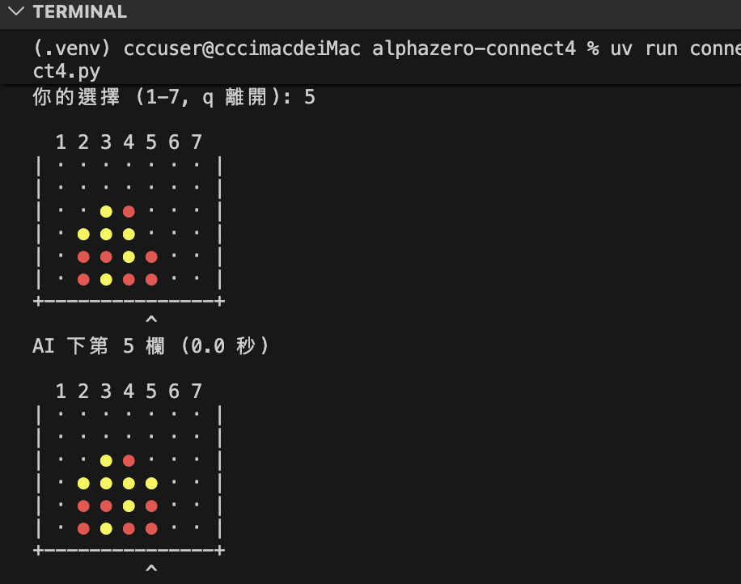

```sh
(.venv) cccuser@cccimacdeiMac alphazero-connect4 % uv run conne
ct4.py
=== Connect 4 四子棋 ===
難度 1=簡單 2=普通 3=困難: 1
你要先手嗎？(Y/n): y
難度：簡單。你是紅色 ●

  1 2 3 4 5 6 7
| · · · · · · · |
| · · · · · · · |
| · · · · · · · |
| · · · · · · · |
| · · · · · · · |
| · · · · · · · |
+---------------+
你的選擇 (1-7, q 離開): 4

  1 2 3 4 5 6 7
| · · · · · · · |
| · · · · · · · |
| · · · · · · · |
| · · · · · · · |
| · · · · · · · |
| · · · ● · · · |
+---------------+
        ^
AI 下第 4 欄 (0.0 秒)

```


